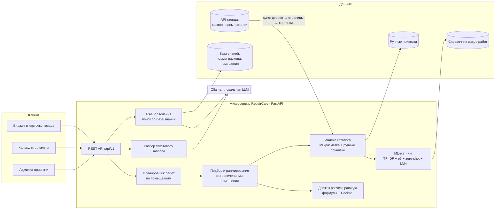
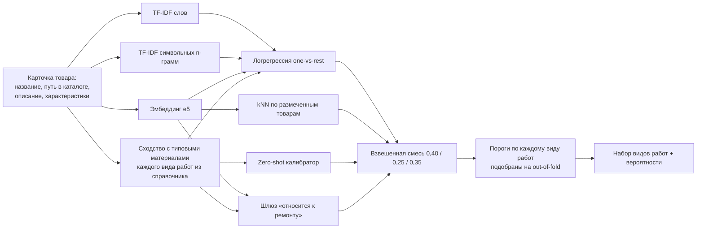

# Архитектура RepairCalc

## Принципы

- **Отдельный stateless-микросервис** (FastAPI, Docker), REST/JSON. Подключается к любому фронту: в карточку
  товара встраивается виджет одной строкой `<script>` (подходит для Bitrix-компонента или AJAX-эндпоинта).
- **Каталог и остатки — источник истины на стороне сайта.** Сервис забирает их через API стенда
  (обход дерева категорий + постраничная загрузка + полные карточки) и держит в памяти индекс с разметкой.
- **Закрытый контур.** Все модели локальные: эмбеддинги `multilingual-e5-small` (MIT) работают на CPU,
  LLM — через Ollama на GPU сервера (Qwen2.5-7B/14B-Instruct, Apache-2.0). Внешних API нет.
  Без LLM сервис полностью работоспособен: разбор текста и пояснения переходят на правила и шаблоны.
- **ML за отдельным слоем.** Модель обучается офлайн (`make train`) и подгружается файлом; инференс
  ≈ 2 мс на товар, поэтому новые товары размечаются синхронно при загрузке. Разметка всего каталога
  (86 тыс. товаров) кэшируется на диск: старт сервиса 12 с, пересчёт — только при смене каталога или модели.

## Схема

## Компоненты

| Модуль | Файл | Назначение |
|---|---|---|
| Каталог | [app/catalog.py](../app/catalog.py), [scripts/build_real_catalog.py](../scripts/build_real_catalog.py) | Загрузка карточек (API стенда или выгрузка организаторов + YML-фид), нормализация характеристик без единиц измерения («Вес 5000» → 5 кг, «.9» → 0,9 л, «2,1-5,2» → 3,65, мм → м), отрицания («не влагостойкие»), извлечение признаков (влагостойкость, моющаяся, класс износостойкости, расход, фасовка, площадь листа). |
| ML-матчинг | [app/ml/matcher.py](../app/ml/matcher.py), [features.py](../app/ml/features.py) | Многометочная классификация «товар → виды работ» и классификация «товар → класс материала». |
| Индекс | [app/service.py](../app/service.py) | Разметка всего каталога при старте и при загрузке новых товаров; ручные привязки из админки имеют приоритет над ML. |
| Планировщик | [app/calc/plan.py](../app/calc/plan.py) | Тип объекта + тип ремонта + помещение → позиции сметы (вид работ, класс материала, база расчёта, требования). |
| Подбор | [app/recommend.py](../app/recommend.py), [app/calc/estimate.py](../app/calc/estimate.py) | Кандидаты по разметке → фильтр позиции по названию (например, «смеситель для раковины», «плинтус») → жёсткие ограничения помещения → ранжирование (уверенность ML, соответствие позиции, наличие в фиде, ценовой сегмент по цене за кг/л/м²) → выбор с учётом итоговой стоимости позиции: «качество минус штраф за переплату» (мешок 20 кг вместо 14 банок по 1,5 кг). |
| Расчёт | [app/calc/formulas.py](../app/calc/formulas.py) | Формулы расхода по классам материала с учётом единицы продажи (упаковка, м², м, шт). Деньги — `Decimal`, итоговая цена — `result_price` стенда. |
| RAG | [app/rag.py](../app/rag.py) | Поиск фрагментов базы знаний по эмбеддингам и пояснение «почему эти материалы» (LLM или шаблон). |
| Текст | [app/nlp.py](../app/nlp.py) | Извлечение объекта, типа ремонта, помещений и площадей из свободного текста. |
| Мок стенда | [app/mock_stand.py](../app/mock_stand.py) | Эмуляция API стенда (тот же формат и пагинация) для демонстрации полного цикла загрузки. |

## ML-модель матчинга

- **Почему гибрид.** Логрегрессия на TF-IDF точна на знакомых типах товаров, но не переносится на новые.
  Zero-shot компонент сравнивает название товара с типовыми материалами каждого вида работ из справочника
  и даёт смысловое сопоставление без обучающих примеров («затирка» ↔ «затирка для швов» → укладка плитки).
  kNN по эмбеддингам переносит разметку похожих товаров. Шлюз отсекает товары вне ремонта (сад, быт).
- **Бренд удаляется из текста** перед обучением: бренд не определяет вид работ и провоцирует переобучение.
- **Пороги** подбираются по каждому виду работ на out-of-fold предсказаниях обучающей выборки.

## API

| Метод | Путь | Назначение |
|---|---|---|
| POST | `/api/v1/calc/general` | Общий калькулятор: объект, тип ремонта, помещения → смета с подбором товаров, формулами и пояснениями |
| POST | `/api/v1/calc/room` | Калькулятор специфики комнаты: рекомендации с учётом влажности, назначения, нагрузки |
| POST | `/api/v1/calc/text` | Смета по текстовому запросу |
| GET | `/api/v1/product/{id}` | Карточка + ML-разметка + похожие товары |
| POST | `/api/v1/product/{id}/calc` | Расчёт количества и цены под размеры + сопутствующие товары |
| GET | `/api/v1/work-types/{id}/products` | Ранжированный список товаров для вида работ |
| POST | `/api/v1/admin/suggest` | ML-подсказка вида работ, класса и помещений для нового товара |
| POST | `/api/v1/admin/ingest` | Загрузка товаров (формат API стенда) с авторазметкой |
| POST | `/api/v1/admin/sync` | Синхронизация со стендом |
| POST/DELETE | `/api/v1/admin/products/{id}/bind` | Ручная привязка / возврат к ML |
| GET | `/api/v1/admin/stats`, `/api/v1/admin/metrics` | Покрытие авторазметкой, время, метрики качества |

Интерактивная документация — `/docs` (Swagger).

## Масштабирование

- Индекс в памяти держит весь каталог (86 тыс. SKU, ≈ 3 ГБ RAM с эмбеддингами). Для сотен тысяч:
  эмбеддинги — в Qdrant/FAISS (интерфейс `similar()`/`search()` не меняется), разметка — фоновой задачей
  по событию изменения каталога, хранение — PostgreSQL.
- Сервис stateless (ручные привязки — файл/БД), поэтому масштабируется горизонтально за балансировщиком.
- Новый сайт или вертикаль (сад, инструмент) = новый справочник видов работ + разметка образца + `make train`.
